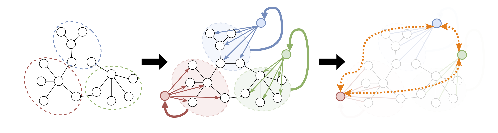

# Fractal-Inspired Message Passing Neural Networks with Fractal Nodes



> **Graph where our fractal nodes are connected.**
> 1.  After partitioning the original graph into subgraphs, we aggregate the low and high-frequency information of each subgraph to create *fractal nodes*.
> 2. Then, we propagate the information to the original nodes (see our proposed $\mathsf{FN}$). 
> 3. We also support the long-distance interactions (orange dashed lines) between fractal nodes (see our proposed $\mathsf{FN}_M$).


## Setup

```bash
conda create --name graph_mlpmixer python=3.8
conda activate graph_mlpmixer

conda install pytorch==1.12.1 torchvision==0.13.1 torchaudio==0.12.1 cudatoolkit=11.3 -c pytorch
conda install -c pyg pytorch-sparse
conda install -c pyg pytorch-scatter
conda install -c pyg pytorch-cluster
conda install -c pyg pyg
pip install ogb
conda install -c conda-forge rdkit
pip install yacs
pip install tensorboard
pip install networkx
pip install einops

conda install -c conda-forge metis
```

## How to Run

- Example:
```
# GCN + FN
python -m train.peptides_struct device 0 fractal.alpha_type vc metis.n_patches 32 model.gnn_type GCNConv fractal.hpf True

# GCN + FN_M
python -m train.peptides_func device 4 fractal.alpha_type vc metis.n_patches 32 model.gMHA_type MLPMixer model.gnn_type GCNConv fractal.hpf True
```

-  Command with best hyperparameters for Peptides-struct

```bash
# GatedGCN + FN_M
python -m train.peptides_struct device 0 fractal.alpha_type sc metis.n_patches 32 model.gMHA_type MLPMixer model.gnn_type ResGatedGraphConv fractal.hpf True model.nlayer_gnn 4 model.nlayer_mlpmixer 2  model.hidden_size 128 fractal.alpha_init zero metis.num_hops 1 metis.drop_rate 0.2
```